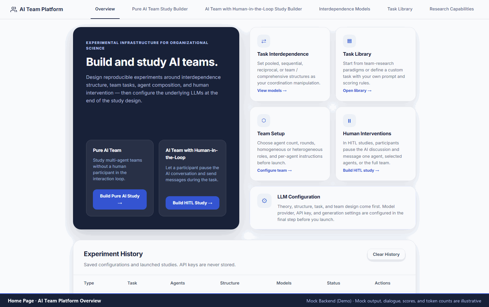
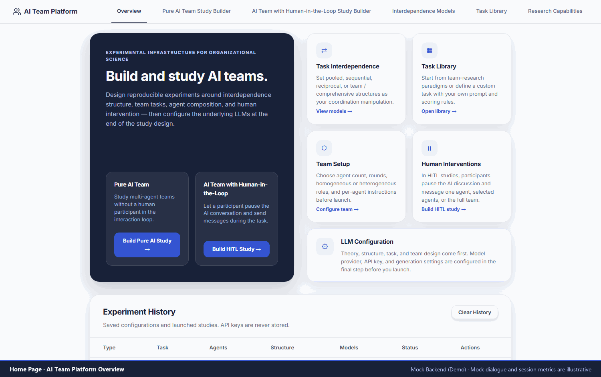
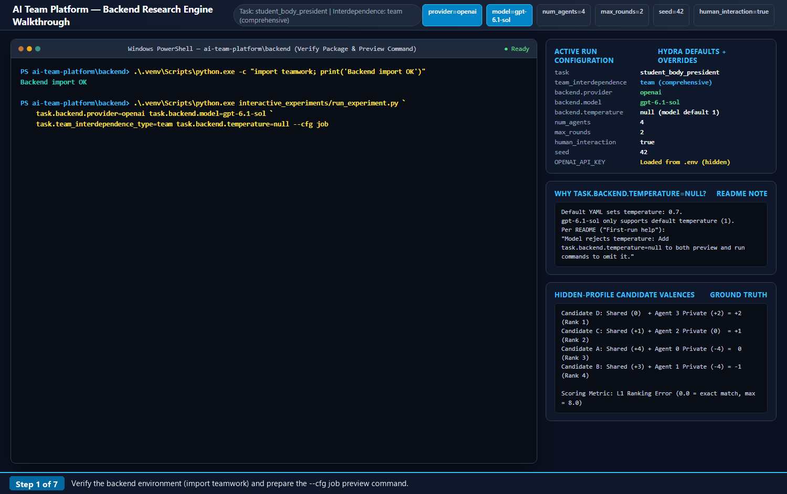

# AI Team Platform: Start Here

Study how AI teams share information, coordinate work, and respond to human intervention. The package contains a browser-based study builder (the GUI) and a separate Python research engine (the backend).

| What would you like to do? | Start here | LLM API key? |
| --- | --- | --- |
| Explore the GUI without installing anything | [Public hosted GUI](https://team-simulation-platform.onrender.com/) | No, with Mock agents |
| Try demonstrations and participant sessions on your computer | [Run the GUI locally](#run-the-gui-locally) | No, with Mock agents |
| Run the scored student-body-president task with real models | [Run the research engine](#run-the-research-engine) | Only for an actual simulation |

**The GUI and backend research engine are not yet integrated.** Configuring or launching a study in the GUI does not launch the backend task. The two programs have separate installations and results.

For GUI demonstrations, select **Use Mock Demo** in LLM Configuration and leave the API key blank. Follow the [GUI walkthroughs](gui/README.md#try-a-pure-ai-demonstration).

## Walkthroughs

### Pure AI Walkthrough



### Human-in-the-Loop Walkthrough



### Backend Walkthrough



## Prepare for local use

Extract the package into a writable folder. You should find `ai-team-platform`, containing `gui` and `backend`. Install **Python 3.11** with pip and virtual-environment support; include the Python launcher (`py`) on Windows. Internet access is needed to install packages.

Open a command window **in the package folder**, without typing a sample folder path:

- **Windows:** Open `ai-team-platform` in File Explorer. Click the address bar, type `powershell`, and press Enter. This opens PowerShell in the package folder, ready for the commands below.
- **macOS:** Open Terminal. Type `cd `, including the space, drag the `ai-team-platform` folder from Finder into the Terminal window, then press Return.
- **Linux:** Open `ai-team-platform` in your file manager and use **Open in Terminal**, if available. Otherwise, type `cd ` in Terminal, paste the folder's full path in double quotes, and press Enter.

Check the folder contents with `Get-ChildItem` on Windows or `ls` on macOS/Linux: both `gui` and `backend` should appear.

### Install Python 3.11

Use Python 3.11 for the local setup. You can install it alongside another Python version; you do not need to uninstall the other version.

**Windows:** Open the [Python 3.11.9 release page](https://www.python.org/downloads/release/python-3119/). Under **Files**, download **Windows installer (64-bit)** and run it. Keep **pip** and the **Python launcher** selected during installation. Open a new PowerShell window in the package folder using the File Explorer method above, then check:

    py -3.11 --version
    py -3.11 -m pip --version

**macOS:** On the same release page, download **macOS 64-bit universal2 installer** under **Files** and run it. Open a new Terminal window, return to the package folder using the method above, then check:

    python3.11 --version
    python3.11 -m pip --version

**Linux:** Install Python 3.11 and its virtual-environment package using your distribution’s package manager. Package names and availability vary by distribution. Check the installation with `python3.11 --version`.

Continue with the virtual-environment commands below. If you previously created a `.venv` folder using another Python version, remove that `.venv` folder and create it again using Python 3.11.

## Run the GUI locally

Use the package-folder PowerShell or Terminal window opened above. The first command below enters the `gui` folder.

**Windows PowerShell**

```powershell
cd gui
py -3.11 -m venv .venv
.\.venv\Scripts\python.exe -m pip install -r requirements.txt
.\.venv\Scripts\python.exe run.py
```

**macOS/Linux Terminal**

```bash
cd gui
python3.11 -m venv .venv
.venv/bin/python -m pip install -r requirements.txt
.venv/bin/python run.py
```

Leave the terminal open and visit **http://127.0.0.1:8000/**. You should see the overview and the Pure AI and human-in-the-loop builders. Start with four agents, two rounds, one replication/session, and **Use Mock Demo**. See the [GUI guide](gui/README.md) for the walkthroughs, downloads, and alternative-port instructions.

**Mock dialogue, displayed scores, and token counts are illustrative, not research outcomes or billed model usage.** Stop the server with **Ctrl+C in its terminal**; closing the browser does not stop it. Save downloads before restarting.

## Run the research engine

If the GUI is running, leave its terminal open. On **Windows**, return to the `ai-team-platform` folder in File Explorer and open a **second PowerShell window** using the address-bar method above. On **macOS/Linux**, open a second Terminal window in the package folder using the method above. The first command below enters `backend`; do not run these commands from inside `gui`.

Install the backend and preview a one-round, AI-only condition:

**Windows PowerShell**

```powershell
cd backend
py -3.11 -m venv .venv
.\.venv\Scripts\python.exe -m pip install -e .
.\.venv\Scripts\python.exe -c "import teamwork; print('Backend import OK')"
.\.venv\Scripts\python.exe interactive_experiments/run_experiment.py task.max_rounds=1 task.human_interaction=false --cfg job
```

**macOS/Linux Terminal**

```bash
cd backend
python3.11 -m venv .venv
.venv/bin/python -m pip install -e .
.venv/bin/python -c "import teamwork; print('Backend import OK')"
.venv/bin/python interactive_experiments/run_experiment.py task.max_rounds=1 task.human_interaction=false --cfg job
```

Expect **Backend import OK**, then settings showing four agents, one round, `team` interdependence, and `human_interaction: false`. **The preview prints settings and exits without a model API call or an API key.** A paid run is not an installation check.

### Optional: run a real simulation

From `backend/`, copy [.env.example](backend/.env.example) to `.env` if it does not already exist. Replace the relevant placeholder key in a text editor. Do not overwrite an existing key file, name it `.env.txt`, or share it.

In [the task configuration](backend/interactive_experiments/configs/task/student_body_president.yaml), set `provider` and `model` under `backend` to match a model available to your account:

| Service | `provider` | Key in `.env` |
| --- | --- | --- |
| Google Gemini, directly | `gemini_direct` | `GEMINI_API_KEY` |
| OpenAI | `openai` | `OPENAI_API_KEY` |
| Anthropic | `anthropic` | `ANTHROPIC_API_KEY` |

Repeat the preview after edits. **Only when ready to incur possible API charges**, run without `--cfg job`:

**Windows PowerShell**

```powershell
.\.venv\Scripts\python.exe interactive_experiments/run_experiment.py task.max_rounds=1 task.human_interaction=false
```

**macOS/Linux Terminal**

```bash
.venv/bin/python interactive_experiments/run_experiment.py task.max_rounds=1 task.human_interaction=false
```

The terminal shows agent contributions and the answer/score. Keep four agents for the supplied prompt. These command overrides do not change the YAML defaults of two rounds with terminal human input enabled. All agents use the same provider/model. Terminal human input is separate from the GUI participant interface.

Press **Ctrl+C** to interrupt a running simulation; unfinished runs may not save final results. Use fictional information for demonstrations and follow your institution's requirements before conducting participant research.

### Try different simulation settings

Run these commands from `ai-team-platform/backend` after completing the backend installation and adding the relevant API key to `.env`. Each command makes model API calls and may incur charges. To check the settings without making an API call, add `--cfg job` to the end of any command.

The supplied student-body-president task uses four agents. The first five examples change the interdependence structure and use the provider and model specified in `interactive_experiments/configs/task/student_body_president.yaml`.

**Windows PowerShell**

```powershell
# Pooled: each agent submits an independent answer
.\.venv\Scripts\python.exe interactive_experiments/run_experiment.py task.team_interdependence_type=pooled task.max_rounds=1 task.human_interaction=false

# Sequential: agents pass information along a chain for two rounds
.\.venv\Scripts\python.exe interactive_experiments/run_experiment.py task.team_interdependence_type=sequential task.max_rounds=2 task.human_interaction=false

# Reciprocal subgroups: subgroups discuss locally, then representatives discuss
.\.venv\Scripts\python.exe interactive_experiments/run_experiment.py task.team_interdependence_type=reciprocal_subgroups task.max_rounds=2 task.small_group_rounds=2 task.human_interaction=false

# Team/comprehensive: all agents share a discussion; no human intervention
.\.venv\Scripts\python.exe interactive_experiments/run_experiment.py task.team_interdependence_type=team task.max_rounds=2 task.human_interaction=false

# Team/comprehensive with human intervention: PowerShell prompts for a message before round two
.\.venv\Scripts\python.exe interactive_experiments/run_experiment.py task.team_interdependence_type=team task.max_rounds=2 task.human_interaction=true
```

**macOS/Linux Terminal**

```bash
# Pooled: each agent submits an independent answer
.venv/bin/python interactive_experiments/run_experiment.py task.team_interdependence_type=pooled task.max_rounds=1 task.human_interaction=false

# Sequential: agents pass information along a chain for two rounds
.venv/bin/python interactive_experiments/run_experiment.py task.team_interdependence_type=sequential task.max_rounds=2 task.human_interaction=false

# Reciprocal subgroups: subgroups discuss locally, then representatives discuss
.venv/bin/python interactive_experiments/run_experiment.py task.team_interdependence_type=reciprocal_subgroups task.max_rounds=2 task.small_group_rounds=2 task.human_interaction=false

# Team/comprehensive: all agents share a discussion; no human intervention
.venv/bin/python interactive_experiments/run_experiment.py task.team_interdependence_type=team task.max_rounds=2 task.human_interaction=false

# Team/comprehensive with human intervention
.venv/bin/python interactive_experiments/run_experiment.py task.team_interdependence_type=team task.max_rounds=2 task.human_interaction=true
```

Human input is currently implemented for the **team** structure only. It appears in the terminal between rounds, so use at least two rounds. It is separate from the GUI participant interface. Pooled runs always produce one independent answer per agent, regardless of the `max_rounds` setting.

To select a provider and model for **every agent**, use one of these complete one-round team examples. The corresponding key must be present in `.env`: `GEMINI_API_KEY`, `OPENAI_API_KEY`, or `ANTHROPIC_API_KEY`.

**Windows PowerShell**

```powershell
# Google Gemini
.\.venv\Scripts\python.exe interactive_experiments/run_experiment.py task.team_interdependence_type=team task.max_rounds=1 task.human_interaction=false task.backend.provider=gemini_direct task.backend.model=gemini-3.8-flash task.backend.temperature=null

# OpenAI
.\.venv\Scripts\python.exe interactive_experiments/run_experiment.py task.team_interdependence_type=team task.max_rounds=1 task.human_interaction=false task.backend.provider=openai task.backend.model=gpt-6-luna task.backend.temperature=null task.seed=null

# Anthropic
.\.venv\Scripts\python.exe interactive_experiments/run_experiment.py task.team_interdependence_type=team task.max_rounds=1 task.human_interaction=false task.backend.provider=anthropic task.backend.model=claude-sonnet-5-5 task.backend.temperature=null
```

**macOS/Linux Terminal**

```bash
# Google Gemini
.venv/bin/python interactive_experiments/run_experiment.py task.team_interdependence_type=team task.max_rounds=1 task.human_interaction=false task.backend.provider=gemini_direct task.backend.model=gemini-3.8-flash task.backend.temperature=null

# OpenAI
.venv/bin/python interactive_experiments/run_experiment.py task.team_interdependence_type=team task.max_rounds=1 task.human_interaction=false task.backend.provider=openai task.backend.model=gpt-6-luna task.backend.temperature=null task.seed=null

# Anthropic
.venv/bin/python interactive_experiments/run_experiment.py task.team_interdependence_type=team task.max_rounds=1 task.human_interaction=false task.backend.provider=anthropic task.backend.model=claude-sonnet-5-5 task.backend.temperature=null
```

**Alternative settings**: the commands above override the YAML defaults only for that run. For changes you want to keep across runs, edit settings such as `provider`, `model`, `max_rounds`, or `human_interaction` in `interactive_experiments/configs/task/student_body_president.yaml` and omit the matching command overrides. All agents use the same provider and model.

**Adding a new LLM provider** (developers only; most researchers can skip this). A provider that is not already supported cannot be added by changing the YAML file alone. A developer must add its API connection and register its provider name in `teamwork/backends.py`, then add API-key lookup in `teamwork/backend_utils.py`. If the connection needs another Python package, that dependency belongs in `pyproject.toml`; the required environment-variable name can be documented in `.env.example`. Once those changes are working, researchers can select the new provider and model in `interactive_experiments/configs/task/student_body_president.yaml`.


## Find backend results

After a successful simulation, open **`ai-team-platform/backend/outputs/`** in your file browser. Open the run's date folder, then its time-named folder. It contains:

| File or folder | What it contains |
| --- | --- |
| `conversation.json` | Each agent's recorded conversation |
| `results.json` | Submitted rankings and scores, by round; pooled runs are saved by agent |
| `.hydra/` | Configuration and command overrides used for that run; this folder may be hidden |
| `run_experiment.log` | The run's log file |

The backend score is **L1 ranking error**: 0 is exact, and lower is better. The maximum is 8 for a valid four-candidate ranking. It is not the GUI's illustrative agreement score. The standard runner does not automatically aggregate pooled rankings or save token/cost summary tables.

## First-run help

- **Errors after switching Python versions:** If you created a `.venv` using another Python version, delete only that program's `.venv` folder and repeat its installation commands. Installing Python 3.11 does not change an existing `.venv`.
- **Python command unavailable:** Install Python 3.11 and its launcher/venv support, reopen the terminal, and repeat the version check.
- **File or module not found:** Use the correct component folder and its `.venv` Python. GUI commands run beside `run.py`; backend commands beside `pyproject.toml`.
- **Port 8000 busy or participant session problems:** See [GUI troubleshooting](gui/README.md#troubleshooting).
- **Backend key, model, or quota error:** Check `.env`, provider/model settings, and account access/credit before retrying a paid run. Preview again first.
- **Model rejects temperature:** Add `task.backend.temperature=null` to both preview and run commands to omit it.

Offline checks used Windows Python 3.11.4. macOS/Linux commands were reviewed but not executed on those systems.

## License and provenance

See [LICENSE](LICENSE) for the MIT license and retained copyright notices. Portions of the backend build on code by Pappu et al.; this attribution concerns those backend portions, not the GUI.
